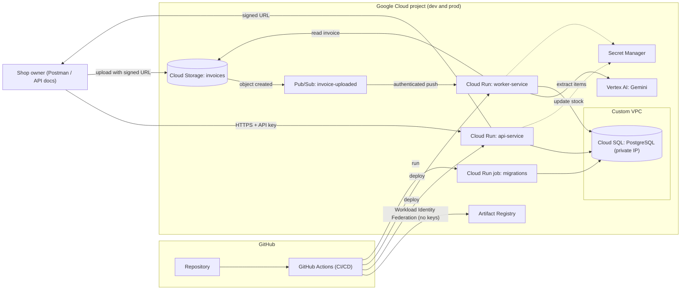
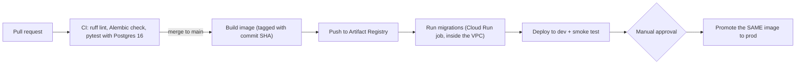

# StockSense

**An AI-assisted inventory system for small shops, built on Google Cloud.**

Small shops receive supplier invoices (PDFs or photos) and type every item into their stock system by hand. With StockSense, the shop owner uploads an invoice, **Gemini reads it**, and **stock updates automatically**. Items that can't be matched are flagged for review.

> **Why this project exists:** It's a hands-on practice project to apply what I learned in Google Cloud's infrastructure courses: Cloud Run, Cloud SQL, private networking, IAM, Pub/Sub, CI/CD with GitHub Actions, and Workload Identity Federation. The app is intentionally small; the focus is a clean, secure, production-style cloud setup.

**Status:** Phases 1–4 of 6 complete (running in separate **dev** and **prod** projects). Next: alerts and observability, then Terraform.

---

## How it works

1. The owner adds products, each with a **low-stock limit**
2. Sales reduce stock (`POST /stock/out`)
3. The owner requests a **signed URL** and uploads a supplier invoice **directly to Cloud Storage**
4. The upload publishes an event to **Pub/Sub**, which pushes it to the **worker**
5. The worker sends the invoice to **Gemini on Vertex AI**, which extracts items and quantities
6. Matched items **increase stock**; unknown items are marked **needs review**
7. The owner checks the result with `GET /invoices/{id}`

---

## Architecture



### CI/CD pipeline



---

## Google Cloud services

| Service | Used for |
|---|---|
| **Cloud Run** | `api-service` and `worker-service` (scale to zero) |
| **Cloud Run jobs** | Database migrations, run inside the VPC |
| **Cloud SQL (PostgreSQL)** | Main database, **private IP only** |
| **VPC** | Custom network, Private Services Access for Cloud SQL, Direct VPC egress from Cloud Run |
| **Cloud Storage** | Invoice files, uploaded directly with **signed URLs** |
| **Pub/Sub** | Bucket notifications, pushed to the worker with an authenticated push subscription |
| **Vertex AI (Gemini)** | Extracting items from invoices |
| **Secret Manager** | Database password and API key |
| **Artifact Registry** | Docker images, with a cleanup policy |
| **IAM + Workload Identity Federation** | Least-privilege service accounts; GitHub deploys with **no service account keys** |

---

## Security and IAM

- **One service account per component** (api, worker, CI/CD), each with only the roles it needs, granted on **specific resources** where possible
- **No service account key files anywhere**: Cloud Run uses attached service accounts, and GitHub Actions uses **Workload Identity Federation**
- WIF access is restricted by **numeric repository ID** (provider condition + IAM binding)
- **Separate dev and prod projects**, each with its own VPC, database, and service accounts
- A separate **developer account** tests least privilege: broad access in dev, **read-only in prod**, and no Gemini access in prod
- Pull-request CI runs **without any cloud credentials**
- `main` is protected: changes require a pull request with passing checks

---

## Key design decisions

| Decision | Why |
|---|---|
| **Two services (api + worker), not full microservices** | Split by workload: fast user requests vs slow background AI processing |
| **One shared database** | Simpler and cheaper at this scale (a deliberate trade-off) |
| **Cloud Run instead of GKE** | Scale to zero and far less to manage for two services |
| **Signed URL uploads** | Files go straight to Cloud Storage, not through the API |
| **Idempotent invoice processing** | Pub/Sub can deliver a message more than once; an invoice must never be counted twice |
| **Migrations as a Cloud Run job** | Runs inside the VPC, so the database never needs a public IP |
| **Build once, promote to prod** | Prod runs the exact image that was tested in dev |
| **Simple item matching (v1)** | The focus is cloud + CI/CD practice; unknown SKUs go to "needs review" |

**Deliberately not used:** Spanner, Bigtable, AlloyDB (built for much larger scale), Filestore (no shared file system needed), and organization policies/folders (require an organization domain).

---

## Testing

- **pytest** with FastAPI's `TestClient`
- Tests run against a **real PostgreSQL 16** (service container in CI), using the project's real Alembic migrations
- **Gemini and Cloud Storage are mocked**, so tests are fast, free, and repeatable
- CI blocks merging and deployment when lint or tests fail

---

## Running locally

Requirements: Docker Desktop and `make`.

```bash
copy .env.example .env      # Windows CMD (macOS/Linux: cp .env.example .env)
make up                     # Postgres + api + worker
make migrate                # apply database migrations
```

- API docs: `http://localhost:8000/docs` (send the `X-API-Key` header from your `.env`)
- Worker: `http://localhost:8001`. Locally there is no Pub/Sub, so you play Pub/Sub yourself by posting a sample message (see `services/worker/samples/` and `services/worker/scripts/send_push.py`)

Everything runs without Google Cloud locally:

| Variable | Local | Cloud Run |
|---|---|---|
| `STORAGE_BACKEND` | `fake` | `gcs` |
| `EXTRACTOR_BACKEND` | `fake` | `gemini` |

Tests and checks:

```bash
make test     # api + worker tests against a separate test database
make lint     # ruff
make check    # what CI runs: lint + tests
```

---

## API

All endpoints except health checks require the `X-API-Key` header.

| Service | Method | Path | Purpose |
|---|---|---|---|
| api | `POST` / `GET` | `/products` | Add and list products |
| api | `GET` | `/products/{sku}` | Get one product |
| api | `POST` | `/stock/out` | Record a sale |
| api | `POST` | `/invoices/upload-url` | Get a signed upload URL |
| api | `GET` | `/invoices`, `/invoices/{invoice_id}` | Invoice status and results |
| api | `GET` | `/health`, `/health/ready` | Liveness and readiness |
| worker | `POST` | `/pubsub/invoice-uploaded` | Pub/Sub push endpoint |
| worker | `GET` | `/health` | Liveness |

---

## Project structure

```
stocksense/
├── services/
│   ├── api/
│   │   ├── app/          main.py, routers/, services/, models, schemas, security, storage
│   │   ├── alembic/      database migrations
│   │   ├── tests/
│   │   └── Dockerfile
│   └── worker/
│       ├── app/          routers/ (Pub/Sub push), extraction/ (Gemini + fake), services/
│       ├── samples/      sample invoices and Pub/Sub messages
│       ├── scripts/      local helpers (send a push, try an extraction)
│       ├── tests/
│       └── Dockerfile
├── ops/                  Cloud Storage lifecycle and Artifact Registry cleanup policies
├── .github/workflows/
│   ├── ci.yml            lint, migration check, tests
│   ├── deploy.yml        build, push, migrate, deploy to dev, promote to prod
│   └── wif-smoke-test.yml
├── docker-compose.yml
├── Makefile
└── .env.example
```

---

## Roadmap

- [x] **Phase 1:** Core API, Cloud SQL (private IP), first Cloud Run deploy
- [x] **Phase 2:** CI/CD with GitHub Actions and Workload Identity Federation (dev → prod)
- [x] **Phase 3:** Signed URL uploads, Pub/Sub, worker service
- [x] **Phase 4:** Invoice extraction with Gemini on Vertex AI
- [ ] **Phase 5:** Low-stock email alerts, monitoring, uptime checks, dashboards, bastion VM with IAP
- [ ] **Phase 6:** Terraform for core infrastructure

---

## Lessons learned

- **Workload Identity Federation has two gates**: the provider's attribute condition and the IAM binding. Binding on **numeric IDs** is more reliable than names
- GitHub changed its **OIDC subject format** for newer repositories, which broke a subject-based binding in prod; binding on `repository_id` was unaffected
- `alembic_version` makes migrations **safe to re-run**; destructive changes should follow **expand → contract**
- Some `gcloud` flags exist only in **beta**
- The API returns a clean **503** when the database is unavailable (verified live with Cloud SQL stopped)

---

## Author

**Kethaka Ranasinghe**, software engineer (Python, FastAPI, Google Cloud)